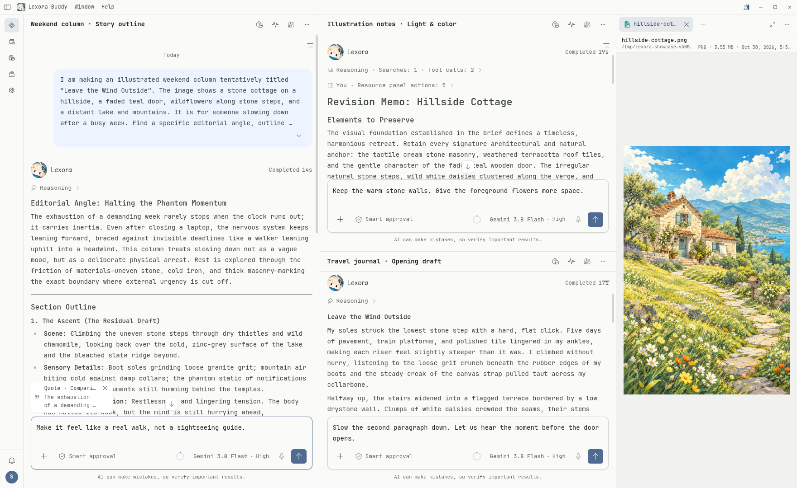
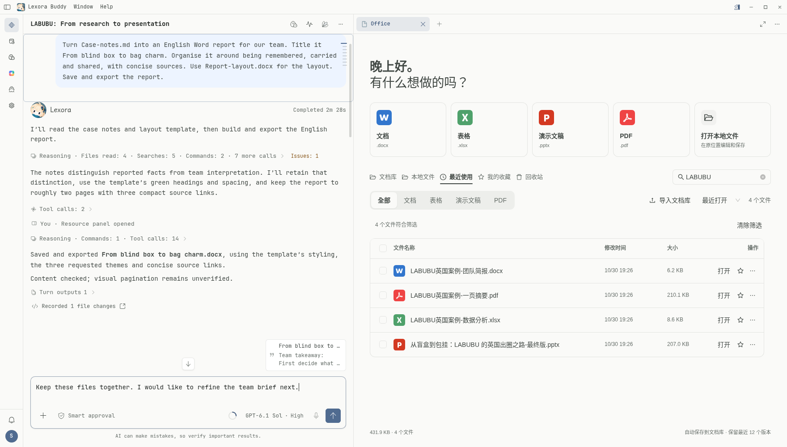
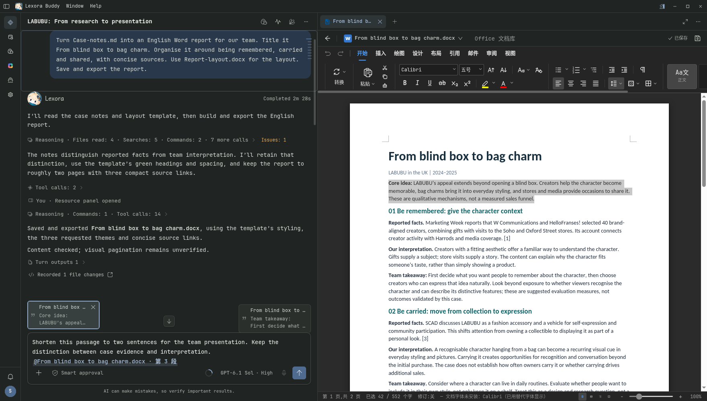
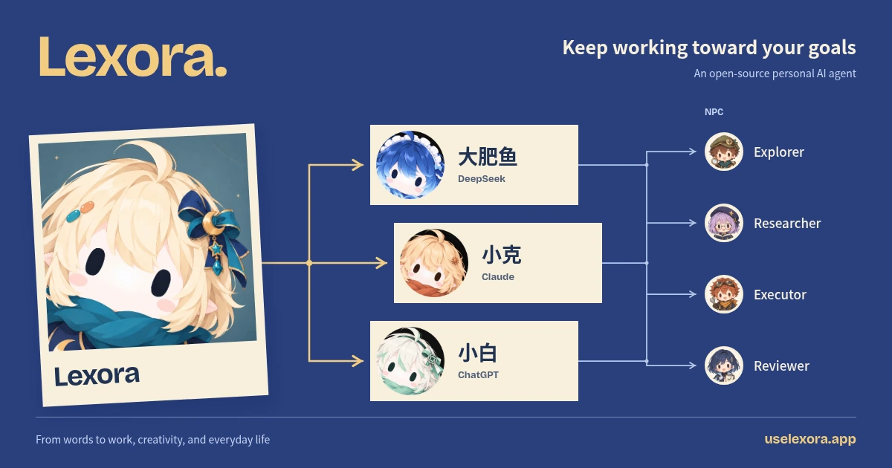
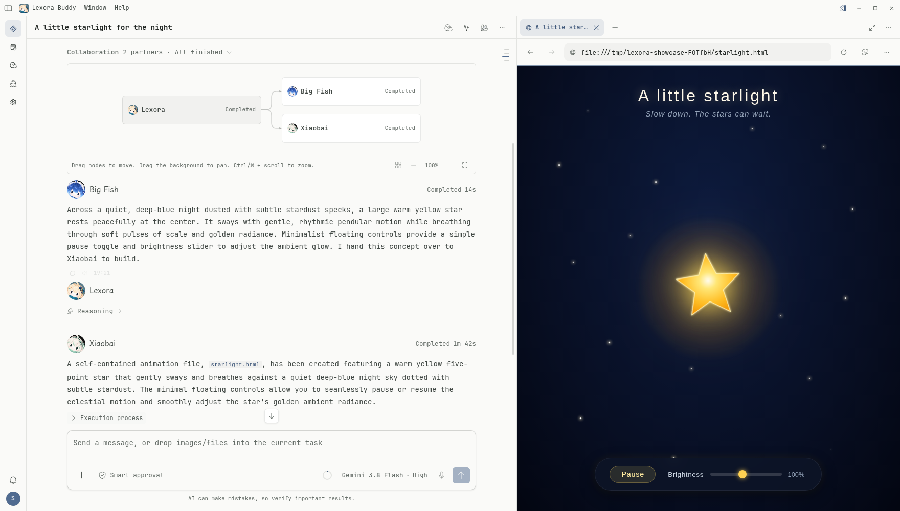

<p align="center">
  
</p>

<h1 align="center">Lexora</h1>

<p align="center"><strong>Think alongside you. Act on your intent.</strong></p>

Lexora is a personal AI agent that evolves through hands-on work on your desktop. Beyond coding, it helps you organize research, refine creative projects, and plan everyday activities. Tell it what you want to accomplish, and it keeps working toward that goal, making words the starting point for work, creativity, and everyday life.

<p align="center">
  <a href="https://github.com/useLexora/Lexora/releases/latest"></a>
  <a href="./LICENSE"></a>
  <a href="https://github.com/useLexora/Lexora/releases"></a>
  <a href="https://uselexora.app/en/guide/quick-start"></a>
</p>

<p align="center">
  <a href="https://github.com/useLexora/Lexora/releases/latest">Download Lexora</a> · <a href="https://uselexora.app/en/">Website</a> · <a href="https://uselexora.app/en/guide/quick-start">Guide</a>
</p>

<p align="center"><a href="./README.md">中文</a> · <strong>English</strong></p>

<p align="center">
  <a href="apps/website/src/public/landing/screenshots/readme-overview-en.webp"></a>
</p>

## Keep working toward your goals

Organize material for work, refine a creative project, or plan a trip. Start with what you want to accomplish. Lexora works through the steps on your desktop while you add direction and review the results.

Conversations and execution records stay with the task. Return later and pick up where you left off. Keep useful methods and tools for the next task, too.

<table>
<tr>
<td width="50%" valign="top">
<h3>Turn research into useful deliverables.</h3>
<p>Use the Office plugin for documents, spreadsheets, presentations, and PDFs. Keep the task discussion beside your files.</p>
<a href="apps/website/src/public/landing/screenshots/readme-office-en.webp"></a>
</td>
<td width="50%" valign="top">
<h3>Quote a passage. Keep refining it.</h3>
<p>Select a passage in Word and bring the original text into your next instruction. Discuss changes with the document in view.</p>
<a href="apps/website/src/public/landing/screenshots/readme-office-word-en.webp"></a>
</td>
</tr>
<tr>
<td width="50%" valign="top">
<h3>Meet your companion crew.</h3>
<p>Let companions bring different strengths, then call on specialist NPCs for research, implementation, and review.</p>
<a href="apps/website/src/public/landing/crew-cover-en.webp"></a>
</td>
<td width="50%" valign="top">
<h3>Share the work. Bring an idea to life.</h3>
<p>Lexora coordinates, Big Fish shapes the idea, and Xiaobai builds it. Follow the conversation beside the working star animation.</p>
<a href="apps/website/src/public/landing/screenshots/readme-collaboration-en.webp"></a>
</td>
</tr>
<tr>
<td width="50%" valign="top">
<h3>Recruit NPCs for the task.</h3>
<p>Choose exploration, research, execution, and review NPCs to give each companion the capabilities the task needs.</p>
<a href="apps/website/src/public/landing/screenshots/readme-npc-zh.webp"></a>
</td>
<td width="50%" valign="top">
<h3>Find the issue. Fix it. Follow through.</h3>
<p>Read files and logs, run commands, and inspect changes while checking the project and pull request in the browser.</p>
<a href="apps/website/src/public/landing/screenshots/readme-project-zh.webp"></a>
</td>
</tr>
</table>

### More capabilities

- **Spaces and tasks**: Organize work by project or topic, pin frequent destinations, and search for existing tasks.
- **Talk while work continues**: Add instructions during a run, queue them for later, or send them into the current run.
- **Conversation branches**: Explore different directions from an existing conversation. View and continue each attempt on the branch canvas.
- **Model choice**: Connect your own model services and choose models for different companions and tasks.
- **Skills**: Reuse writing guidelines, research workflows, and project conventions across tasks.
- **MCP**: Bring tools from local or remote services into your work.
- **Changes and execution records**: Inspect tool activity, command output, and recorded file changes.
- **Usage tracking**: View token usage by task and model to understand where your quota goes.
- **Permissions**: Choose read-only, manual approval, smart approval, or full access. Adjust permissions or stop the task during execution.

## Plugins that fit the way you work

Build a file-analysis panel for research, a custom tool for creative work, or a player for your breaks. Something you need once can become a tool you reach for again.

Install from the plugin marketplace, or describe what you need in a conversation. Your companion can generate the source and install package. Confirm installation, try it, and keep refining it. The source stays in your task workspace to maintain and share.

A plugin can combine these capabilities:

- **Interface and appearance**: Pages, split panels, widgets, full themes, and window effects put tools within reach.
- **Interaction and data**: Menus, input commands, authorized local files, settings, and private storage let a tool remember how you use it.
- **Companions and models**: Add agent instructions and custom tools, call configured models, and return summaries, conversions, or analysis to the task.
- **Events and schedules**: React to task progress, schedule commands, and send system notifications to connect repeatable steps.

Plugins use host capabilities within declared permissions. Scheduled commands need Lexora running and the computer awake.

[Explore plugins](https://uselexora.app/en/guide/settings-and-models#plugins-extend-the-workspace) · [Browse plugin source](https://github.com/useLexora/plugins)

## Local first

**Lexora open-sources its own code. Yours stays yours.**

Lexora does not bundle your entire project and upload it to our servers in the background. Here is where data stays and where requests go:

| Data | Storage or destination |
| --- | --- |
| Project files | Read and written in your local directories |
| Tasks, companions, and settings | Stored on your computer, with backup and restore |
| API keys and login credentials | Encrypted locally using your operating system’s encryption facilities |
| Model requests | Sent from your computer to the model endpoint you configure, without a Lexora cloud relay |
| External tool calls | Sent to MCP services you enable or addresses a plugin is allowed to access |
| Remote backups | Configured and enabled by you, using your chosen WebDAV or S3 storage |

When you use a remote model, conversations, quoted material, and code or file contents read by tools and included in context are sent to that model service. External tools also receive the data their calls require. The services you choose determine how that data is handled.

## Get started

1. [Download the app](https://github.com/useLexora/Lexora/releases/latest): available for Windows, Ubuntu / Debian, Fedora, and Arch Linux on x64 / ARM64, and macOS 15+ on Apple Silicon.
2. Connect a model service in settings using its API key or account authorization.
3. Start a task and give Lexora a goal. Choose a working directory when you want to work with files.

No Lexora account is required. Model credits are not included; providers have their own terms and charges.

See the [guide](https://uselexora.app/en/guide/quick-start) for a walkthrough. The first macOS installation requires the `xattr` command shown in the guide. Scheduled tasks need Lexora running and the computer awake.

## Development and contributions

### Local development

Requires Node.js 26+, pnpm 12.5.1+, and Rust. See the [build instructions](packaging/buddy/README.md) for platform dependencies. From the repository root:

```bash
pnpm --filter @uselexora/lexora --filter '@uselexora/lexora-buddy...' --filter @uselexora/lexora-website install --frozen-lockfile
pnpm dev
```

### Contributing

[Open an issue](https://github.com/useLexora/Lexora/issues) if you find a problem. If you have already put an idea into practice, we welcome a PR following the [contribution guide](CONTRIBUTING.md)—share what you have built with everyone.

## License

[AGPL-3.0-only](LICENSE)

## Friendly links

[LINUX DO — A new ideal community](https://linux.do/)
