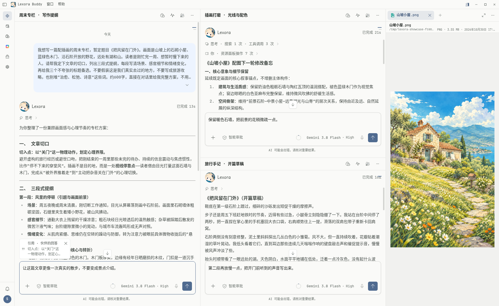
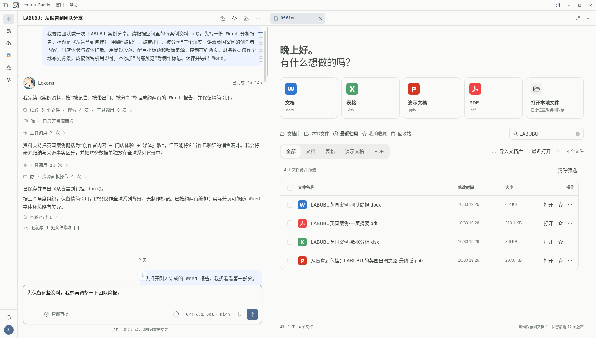
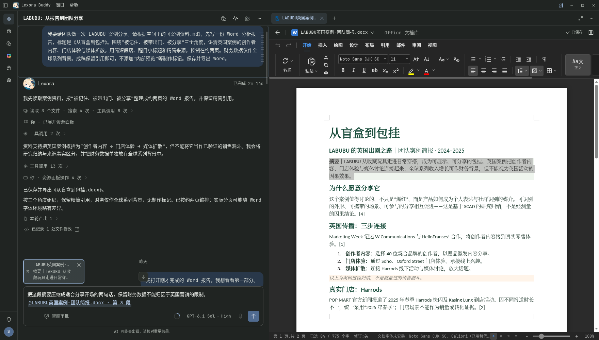
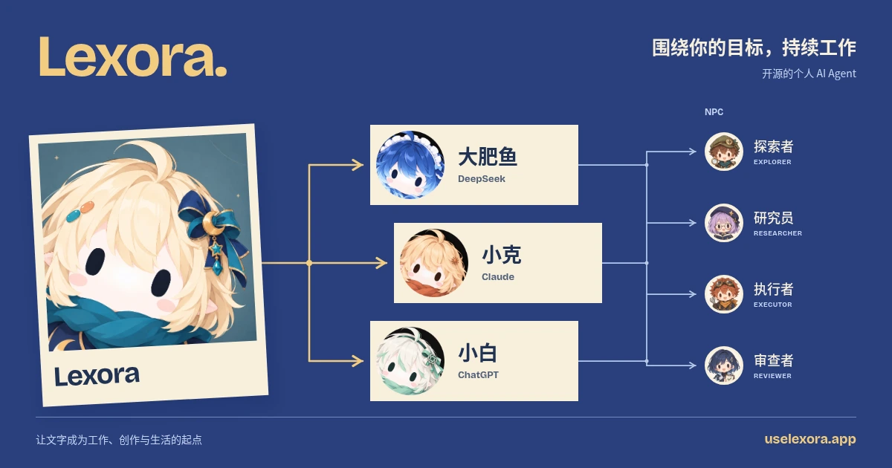
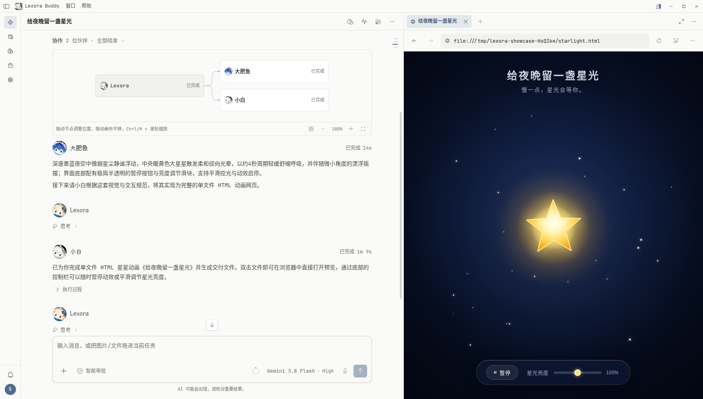
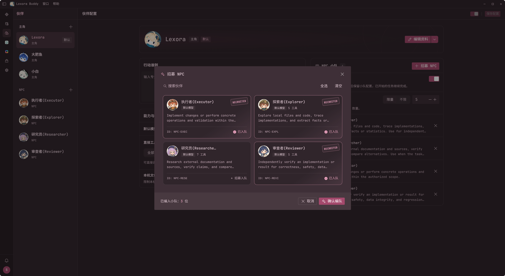
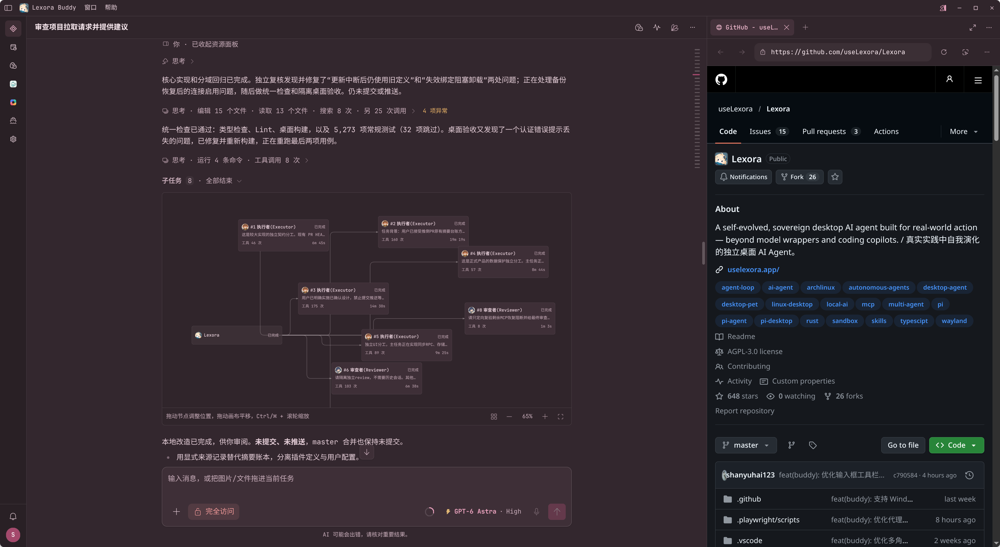

<p align="center">
  
</p>

<h1 align="center">Lexora</h1>

<p align="center"><strong>想你所想，行你所行。</strong></p>

Lexora 是在真实桌面实践中自我演化的个人 AI Agent。它不局限于代码助手的角色，也能陪你整理资料、打磨作品、安排日常。你说出目标，它持续推进，让文字成为工作、创作与生活的起点。

<p align="center">
  <a href="https://github.com/useLexora/Lexora/releases/latest"></a>
  <a href="./LICENSE"></a>
  <a href="https://github.com/useLexora/Lexora/releases"></a>
  <a href="https://uselexora.app/guide/quick-start"></a>
</p>

<p align="center">
  <a href="https://github.com/useLexora/Lexora/releases/latest">下载 Lexora</a> · <a href="https://uselexora.app/">官网</a> · <a href="https://uselexora.app/guide/quick-start">使用指南</a>
</p>

<p align="center"><strong>中文</strong> · <a href="./README.en.md">English</a></p>

<p align="center">
  <a href="apps/website/src/public/landing/screenshots/readme-overview-zh.webp"></a>
</p>

## 围绕目标，持续工作

从工作中的资料整理、创作中的反复打磨，到生活里的行程规划，先说出你想完成的事。Lexora 围绕目标安排步骤，在你的桌面上持续推进，你可以随时补充要求、查看成果。

对话和执行记录会保留在任务中。今天没做完的事，下次打开接着做；用顺手的方法和工具，也可以留下来继续用。

<table>
<tr>
<td width="50%" valign="top">
<h3>把资料整理成可用的成果</h3>
<p>用 Office 插件集中处理文档、表格、演示文稿和 PDF，随时对照任务讨论与已有资料。</p>
<a href="apps/website/src/public/landing/screenshots/readme-office-zh.webp"></a>
</td>
<td width="50%" valign="top">
<h3>引用具体段落，继续打磨</h3>
<p>选中 Word 里的段落，带着原文提出修改要求；一边沟通，一边查看文档。</p>
<a href="apps/website/src/public/landing/screenshots/readme-office-word-zh.webp"></a>
</td>
</tr>
<tr>
<td width="50%" valign="top">
<h3>认识你的伙伴小队</h3>
<p>让不同伙伴各展所长，再按需调用专业 NPC，把构思、研究、执行与审查串起来。</p>
<a href="apps/website/src/public/landing/crew-cover-zh.webp"></a>
</td>
<td width="50%" valign="top">
<h3>伙伴分工，一起完成作品</h3>
<p>Lexora 统筹，大肥鱼构思，小白实现。从对话里的分工，到右侧可运行的星星动画。</p>
<a href="apps/website/src/public/landing/screenshots/readme-collaboration-zh.webp"></a>
</td>
</tr>
<tr>
<td width="50%" valign="top">
<h3>按需招募 NPC</h3>
<p>为伙伴挑选探索、研究、执行和审查 NPC，按任务需要组合能力。</p>
<a href="apps/website/src/public/landing/screenshots/readme-npc-zh.webp"></a>
</td>
<td width="50%" valign="top">
<h3>查问题、改代码、跟进结果</h3>
<p>读文件、查日志、执行命令和检查改动，同时打开浏览器核对项目与拉取请求。</p>
<a href="apps/website/src/public/landing/screenshots/readme-project-zh.webp"></a>
</td>
</tr>
</table>

### 更多能力

- **空间与任务管理**：按项目或主题组织任务，置顶常用入口，通过搜索找回已有任务。
- **执行中继续沟通**：工作没结束也能补充要求，选择排队处理，或把消息送入当前执行。
- **对话分支**：从已有对话尝试不同方向，在分支画布中查看并继续，保留各次尝试。
- **模型自由选择**：连接自己的模型服务，为不同伙伴和任务选择合适的模型。
- **Skills**：把写作规范、研究流程和项目约定保存为可复用的工作方法。
- **MCP**：接入本地或远程服务，把已有工具带进任务。
- **变更与执行记录**：查看工具做过什么、命令返回什么，以及已记录的文件改动。
- **用量统计**：按任务、模型查看 Token 消耗，了解额度花在了哪里。
- **权限选择**：按任务选择只读、人工审批、智能审批或完全访问，执行中也可以调整或停止。

## 插件，让 Lexora 越用越合手

为整理资料做一个文件分析面板，给创作加一套专用工具，或在休息时打开自己的播放器。一次临时的需要，可以变成以后随手可用的功能。

你可以从插件市场安装，也可以直接在对话里描述需求，让伙伴生成源码与安装包。确认安装后继续试、继续改，源码留在任务工作区，方便自己维护和分享。

插件可以把这些能力组合起来：

- **界面与外观**：独立页面、分屏面板、小组件、完整主题与窗口特效，让功能出现在顺手的位置。
- **交互与数据**：菜单和输入命令、获准访问的本地文件、独立设置与私有存储，让小工具记住你的用法。
- **伙伴与模型**：提供 Agent 指令和专用工具，调用已配置的模型，把摘要、转换或分析结果交回任务。
- **事件与定时**：响应任务进展、定时执行命令、发送系统通知，把重复步骤连起来。

插件按声明的权限使用宿主能力。定时命令需要 Lexora 运行、电脑保持唤醒。

[了解插件](https://uselexora.app/guide/settings-and-models#插件-扩展工作台) · [浏览插件源码](https://github.com/useLexora/plugins)

## 本地优先

Lexora 不会在后台把你的整个项目打包上传到我们的服务器，**不替你“开源”你的代码**。数据存在哪里、请求发给谁，写在这里：

| 数据 | 保存位置或发送目标 |
| --- | --- |
| 项目文件 | 你的本地目录，直接在本机读写 |
| 任务记录、伙伴与设置 | 保存在本机，支持备份与恢复 |
| API Key 与登录凭据 | 使用操作系统提供的加密能力，在本机加密保存 |
| 模型请求 | 从本机发往你配置的模型服务，不经过 Lexora 云端中转 |
| 外部工具调用 | 发往你启用的 MCP 服务或插件获准访问的地址 |
| 远程备份 | 由你配置并启用，上传到你指定的 WebDAV 或 S3 存储 |

使用远程模型时，对话、引用内容，以及工具读到并放入上下文的代码或文件内容，会发送给对应的模型服务。外部工具也会收到调用所需的数据，具体处理方式取决于你选择的服务。

## 开始使用

1. [下载安装包](https://github.com/useLexora/Lexora/releases/latest)：支持 Windows、Ubuntu / Debian、Fedora、Arch Linux 的 x64 / ARM64，以及 macOS 15+ 的 Apple Silicon。
2. 在设置中连接模型服务，按服务商要求配置 API Key 或账号授权。
3. 新建任务，给 Lexora 一个目标；需要处理文件时，再选择工作目录。

无需注册 Lexora 账号。Lexora 不内含模型额度，模型服务的使用条件与费用以服务商为准。

详细步骤见[使用指南](https://uselexora.app/guide/quick-start)。macOS 首次安装需要按指南执行一次 `xattr` 命令。定时任务需要 Lexora 保持运行、电脑保持唤醒。

## 参与开发

### 本地开发

需要 Node.js 26+、pnpm 12.5.1+ 与 Rust 工具链；平台依赖见[构建说明](packaging/buddy/README.md)。在仓库根目录运行：

```bash
pnpm --filter @uselexora/lexora --filter '@uselexora/lexora-buddy...' --filter @uselexora/lexora-website install --frozen-lockfile
pnpm dev
```

### 参与贡献

发现问题，欢迎[提个 Issue](https://github.com/useLexora/Lexora/issues)。若你已经动手实现了自己的想法，欢迎按[贡献说明](CONTRIBUTING.md)提交 PR，和大家分享你的方案。

## 许可证

[AGPL-3.0-only](LICENSE)

## 友情链接

[LINUX DO — 新的理想型社区](https://linux.do/)
